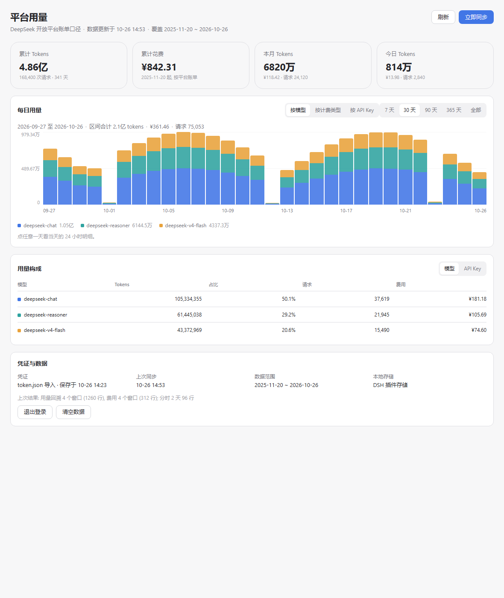

# dsh-deepseek-platform-usage

DeepSeek Harness（DSH）插件：把 **DeepSeek 开放平台的账单用量**搬进设置页。

按 API Key 计费的每日 tokens 与**真实金额**、按模型 / 计费类型 / API Key 的拆分、某一天的 24 小时明细，全部在 DSH 里查看，不需要额外开一个桌面程序。

> 非官方工具。数据来自 `platform.deepseek.com` 上「用量信息」页面调用的私有接口，接口没有公开文档、可能随平台改版失效。请仅用于统计本人账号。

## 目录

- [它能做什么](#它能做什么)
- [界面](#界面)
- [环境要求](#环境要求)
- [安装](#安装)
- [使用说明](#使用说明)
  - [第 1 步：拿到 userToken](#第-1-步拿到-usertoken)
  - [第 2 步：绑定凭证](#第-2-步绑定凭证)
  - [第 3 步：首次同步](#第-3-步首次同步)
  - [读懂面板](#读懂面板)
  - [日常使用](#日常使用)
- [统计口径](#统计口径)
- [数据与隐私](#数据与隐私)
- [常见问题](#常见问题)
- [更新与卸载](#更新与卸载)
- [HTTP 接口](#http-接口)
- [开发与测试](#开发与测试)
- [已知限制](#已知限制)
- [许可](#许可)

## 它能做什么

- **今天 / 本月 / 累计**用了多少 tokens、花了多少钱（平台账单口径，不是按价格表估算）。
- **按维度拆解**：切换「按模型 / 按计费类型 / 按 API Key」，看同一段时间里各占多少。
- **看趋势**：每日堆叠柱状图，支持 7 / 30 / 90 / 365 天与全部历史。
- **看时段**：点任意一天的柱子，切换成当天 24 小时的分时明细（平台只保留最近两天的小时数据，插件每次同步会把它们存下来）。

## 界面



*示例数据（离线 fixture），非真实账单。*

## 环境要求

| 项目 | 要求 |
|---|---|
| DSH | `>= 0.2.0-rc.2 < 0.3.0`（见 `package.json` 的 `dsh.compatibility`） |
| Node | `>= 22`（宿主半区用 `AbortSignal.timeout`、`fetch`） |
| 网络 | 能访问 `https://platform.deepseek.com`；同步走宿主进程，代理环境见 [常见问题](#常见问题) |
| 凭证 | 一个 DeepSeek 开放平台的 `userToken`（见第 1 步） |

## 安装

插件包不在 npm 上，用打包后的 tarball 安装。

```powershell
# 1. 在源码目录打包
cd <本仓库源码目录>
npm pack
#    → dsh-deepseek-platform-usage-0.1.3.tgz

# 2. 装进 web profile（路径用正斜杠）
dsh plugin --profile web add file:C:/path/to/dsh-deepseek-platform-usage-0.1.3.tgz
```

安装会做三件事：把包写进 profile 的 `dependencies`、把插件名追加到 `dsh.profile.bundles`、把文件解到 `node_modules`。

装完后**重启 DSH Desktop**（或由 HMR 重新组合），再**刷新页面**（Ctrl+R）。设置页左侧会多出一项「平台用量」。

> Windows 上直接 `dsh plugin add file:D:/某个目录`（目录而不是 tarball）会因 pnpm 的路径解析报 `ENOENT`，请走 tarball。

## 使用说明

### 第 1 步：拿到 userToken

`userToken` 是平台登录成功后写在浏览器 `localStorage` 里的会话凭证。平台没有 OAuth，也没有「用 API Key 换 token」的接口，所以这一步只能在**已登录的浏览器**里手工取一次。

三种取法，任选其一：

**方法 A：DevTools 面板（最直观）**

1. 浏览器打开 <https://platform.deepseek.com> 并登录；
2. 按 `F12` 打开开发者工具 → **Application**（Firefox 叫「存储」）→ **Local Storage** → `https://platform.deepseek.com`；
3. 在右侧找到键 `userToken`，它的值是 `{"value":"一串不透明字符","__version":"0"}`；
4. 复制整段值（插件会自己剥掉外层包装），或者只复制 `value` 里面的那串。

**方法 B：Console 一行**

在同一个页面的 Console 里执行：

```js
copy(JSON.parse(localStorage.getItem('userToken')).value)
```

token 直接进剪贴板（`copy()` 只在 DevTools 里可用）。

**方法 C：从请求头抄**

`F12` → **Network** → 刷新页面 → 随便点开一条 `/api/v0/usage/...` 请求 → **Headers** → Request Headers → `authorization: Bearer xxxxx` → 复制 `Bearer ` 后面那段。

> 这串 token 等价于该账号的**只读账单权限**（能看用量、费用、API Key 列表）。按密码对待：不要贴到聊天里、不要提交进仓库。它只存在本机的插件存储中。

### 第 2 步：绑定凭证

设置 → **平台用量**，第一次打开会看到「绑定平台凭证」，两种方式选一种：

| 方式 | 操作 | 说明 |
|---|---|---|
| 从 `token.json` 导入 | 填一个 JSON 文件的绝对路径 → 点「导入并验证」 | 文件内容形如 `{"user_token": "..."}`；也接受 `{"value":"...","__version":"0"}` 和纯文本。路径会记在本机，下次自动填好 |
| 粘贴 userToken | 切到「粘贴 userToken」，粘进去 → 点「校验并保存」 | 不用建文件，最快 |

两种方式都会**先验证再落盘**：插件用 `GET /api/v0/users/get_user_summary` 试一次，失败会在面板里显示原因（过期、网络、返回格式不对），不会写入半截凭证。

### 第 3 步：首次同步

绑定成功后会自动跑一次同步，也可以随时点右上角「**立即同步**」。过程中按钮会显示当前阶段（`同步中…` → `同步费用…` → `同步分时…`），期间可以继续用别的设置页。

首次同步做的事：

1. 以 30 天为窗口，从今天往前逐段拉取 `usage/by_api_key/amount` 与 `usage/by_api_key/cost`；
2. **连续两个空窗口即停止**——刚注册的账号通常 3 个窗口就结束，有两年历史的账号会多跑十几轮；
3. 再抓今天和昨天的 `bucket=3600` 分时；
4. 拉一次账号汇总（余额/累计花费）做快照。

请求是串行的，每个之间隔 300ms。第一次通常几秒到十几秒；历史越长窗口越多，按窗口数线性增长。

同步结束后，卡片和图表会自己刷新。标题行会显示「数据更新于 MM-DD HH:mm」。

### 读懂面板

**① 概览卡片**

| 卡片 | 含义 |
|---|---|
| 累计 Tokens | 本地已有全部历史之和，副标题是请求数与覆盖天数 |
| 累计花费 | 平台 `cost` 接口返回的金额之和，币种跟随平台 |
| 本月 Tokens | 当前自然月（GMT+8）的 tokens 与费用 |
| 今日 Tokens | 今天（GMT+8）的 tokens 与费用 |

**② 每日用量**

- 右上角两个开关：**分组**（按模型 / 按计费类型 / 按 API Key）和**范围**（7 / 30 / 90 / 365 天 / 全部）。
- 每根柱子是一天的总量，颜色按当前分组堆叠；图例在下方，带各段合计。
- 鼠标悬停（或键盘 Tab 聚焦）任意柱子，会浮出当天明细：tokens、请求数、费用，以及占比最高的几段。
- **点柱子**进入该日分时视图；左上角「← 返回按天」回到日视图。
- 没有数据的日期画成 0，而不是跳过——空档期不会被压缩成一格。

**③ 分时视图**

24 个小时一格不少（安静的凌晨也占一格）。柱高是当小时 tokens，悬浮能看到当小时费用与请求数。平台只保留最近两天的小时数据，更早的日期点进来会是空状态并给出说明。

**④ 用量构成**

「模型 / API Key」两个页签，列出该区间的 tokens、占比、请求数、费用。占比按 tokens 计算。

**⑤ 凭证与数据**

显示凭证来源（文件导入 / 手动粘贴）、保存时间、上次同步时间、数据覆盖范围、本地存储位置；「自动同步」下拉可选择间隔或关闭，右侧提示下次预计同步时刻；底部是「退出登录」和「清空数据」。

### 日常使用

- **自动同步**：默认每 30 分钟一次。到点且没有正在进行的同步时，插件在后台拉一次增量（1 个日窗口 + 今明两天分时 + 汇总，共 7 个请求），完成后面板自己刷新。间隔可在「凭证与数据 → 自动同步」里改成 15 分钟 / 1 小时 / 3 小时或关闭；关闭后仍会在启动时补一次（门槛 12 小时）。
- **手动同步**：右上角「立即同步」，任何时候都可以点；正在同步时按钮禁用。
- **刷新**：右上角「刷新」只重新读取本地数据和状态，不联网。
- **退出登录**：清除凭证，保留数据（之后可以换 token 再绑）。
- **清空数据**：删除全部用量/费用/分时行，保留凭证与自动同步设置，面板回到空状态。

## 统计口径

- **tokens** = `input_cache_hit_tokens` + `input_cache_miss_tokens` + `output_tokens`。
  平台同时返回 `prompt_tokens` 这类汇总桶，与拆分桶相加会重复计，插件不把它们计入 tokens。
- **请求数** = `REQUEST` 桶之和，单独统计，不加进 tokens。
- **费用** 直接取 `usage/by_api_key/cost` 的返回值，不做本地计价；币种跟随平台（通常 `CNY`）。
- **日期** 一律按 **GMT+8** 的日历日切分（与平台页面一致），与运行机器的时区无关。
- **幂等**：每行按 `日期 + 模型 + API Key + 类型`（费用行再加币种）覆盖写入，重跑任意窗口不会翻倍；平台删掉久远数据也不会抹掉本地历史。
- **账号一致性**：第一个窗口返回的 API Key 集合若与本地记录的完全不相交，判定为换了账号，**中止且不写入任何数据**，面板提示先「清空数据」。

## 数据与隐私

- 全部数据存在 DSH 的插件存储里（`ctx.storage` 的 JSON KV 单元 `dsh_platform_usage`），不上传到任何第三方。
- `userToken` 明文保存在同一处，只用于同步。
- 插件只向 `https://platform.deepseek.com` 发请求，`Authorization: Bearer <token>`。
- 插件的 HTTP 路由只服务回环地址（非回环来源直接 403），写操作还要求本次启动随机生成的 capability token——跨源页面读不到它。
- 自动同步只在 DSH 进程运行期间发生；DSH 没开就不会有任何请求。

## 常见问题

**Q：多久更新一次？要一直点同步吗。**
不用。默认**每 30 分钟**自动同步一次（可在面板「凭证与数据 → 自动同步」里改成 15 分钟 / 1 小时 / 3 小时或关闭），DSH 启动时如果距上次成功同步已超过间隔也会立刻补一次。面板开着时每 30 秒会重新读一次状态，所以后台同步完，数字和图会自己更新。

**Q：自动同步会不会很费流量。**
不会。第一次同步之后，本地已经覆盖到最近的日期，后续每次只需拉 1 个 30 天窗口（日用量 + 费用各一次）、今天和昨天的分时（4 次）、账号汇总（1 次），共 7 个请求、串行、间隔 300ms，通常两三秒结束。

**Q：关掉自动同步后，启动还会同步吗。**
会，但门槛放宽到 12 小时：启动时若距上次成功同步超过 12 小时，补一次。完全不希望自动联网，可以把间隔设为「关闭」并忽略启动提示——只有你点「立即同步」时才发请求。

**Q：面板顶部提示「登录已过期」。**
平台让会话失效了（你在别处退出登录、或隔了很久）。重新走第 1 步拿一个新 token，用「退出登录」→ 重新绑定即可；已有数据不会丢。

**Q：提示「当前 token 属于另一个账号」。**
本地的历史属于旧账号，插件的 KEY 集合与当前响应完全不相交。确认要换成新账号后，点「清空数据」→ 再「立即同步」。

**Q：绑好了，但图表是空的。**
确认同步跑完（右上角不显示「同步中…」、标题行有「数据更新于…」）。如果范围选的是「7 天」而最近一周确实没调用，图就是平的；切到「全部」看看最早的数据到哪天。

**Q：分时视图是空的。**
平台只保留今天和昨天的按小时数据。每同步一次，插件才会把当时的两天存下来；超过两天的日期只有按日汇总。

**Q：同步报「网络请求失败」「请求超时」。**
宿主进程（Node）的 `fetch` **不读 Windows 系统代理**。如果必须走代理上网，需要给 DSH 进程设置环境变量 `HTTPS_PROXY=http://127.0.0.1:<端口>` 后重启 DSH Desktop。

**Q：数字和平台页面差一点。**
两边抓取时刻不同（面板只在你同步时更新），跨日边界时还会受「按 GMT+8 切日」影响。看起来差一天，通常是同步时间点不同造成的。

**Q：能同时显示多个账号吗。**
不能。插件一次只保存一个 token，换账号请先「清空数据」。

**Q：数据能导出/备份吗。**
当前版本没有导出入口（见[已知限制](#已知限制)），数据在插件存储里。

## 更新与卸载

```powershell
# 更新：重新打包后覆盖安装（版本号变了才会真正替换）
npm pack
dsh plugin --profile web add file:C:/path/to/dsh-deepseek-platform-usage-<新版本>.tgz

# 卸载（数据保留在插件存储里）
dsh plugin --profile web remove dsh-deepseek-platform-usage
```

改完源码**不会**自动生效——profile 里跑的是 tarball 的副本，必须重新打包安装。

## HTTP 接口

宿主半区注册在 `/api/dsh-platform-usage` 下，只服务回环地址：

| 方法 | 路径 | 说明 |
|---|---|---|
| GET | `/status` | 状态、同步进度、汇总、本次的写入令牌 |
| POST | `/token` | 导入 `{ "path": "..." }` 或粘贴 `{ "token": "..." }` |
| POST | `/logout` | 清除凭证（保留数据） |
| POST | `/sync` | 触发一次同步（异步，返回 202） |
| POST | `/clear` | 清空数据（保留凭证） |
| POST | `/config` | 设置自动同步间隔 `{ "autoSyncMinutes": 30 }`（0 = 关闭，上限 1440） |
| GET | `/series?days=30&group=model` | 日粒度序列；`days` 可为数字或 `all`，`group` 为 `model` / `type` / `key` |
| GET | `/hourly?date=YYYY-MM-DD&group=model` | 单日 24 小时序列 |
| GET | `/breakdown?days=30` | 模型 / Key / 类型汇总 |

POST 请求需要带 `x-dsh-platform-usage-token` 头，值来自 `GET /status` 返回的 `token`。

## 开发与测试

```
lib/platform.js   平台接口客户端与归一化 (纯函数, fetch 可注入)
lib/store.js      行模型、聚合与序列化 (纯函数)
lib/plugin.js     宿主半区: KV 持久化、同步编排、HTTP 路由
client.js         浏览器半区: 设置页分区、CSS 堆叠柱
test/             node:test 套件, 全离线 (含假平台端到端流程)
```

```bash
npm test        # 28 个用例, 含假平台端到端: 导入→同步→面板→清空→登出
npm run check   # 语法检查 + 测试
```

改完源码 → `npm pack` → 按「更新与卸载」重装 → 刷新页面。

## 已知限制

- **私有接口**：平台未公开这些接口，改版会让同步失败（会显式报错，不会算错）。
- **分时只有两天**：平台限制，超过两天的日期只有按日数据。
- **没有导出/导入**：数据只在插件存储里，暂时不能备份成文件。
- **没有自定义起止日期**：只有 7 / 30 / 90 / 365 天与全部。
- **单账号**：一次只保存一个 `userToken`。
- **没有累计曲线与热力图**：第一版只做了日趋势 + 分时 + 构成表。

## 许可

[MIT](LICENSE)
